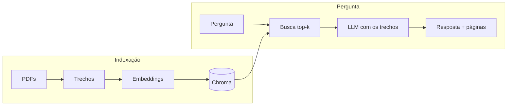

# [Nome do projeto]

> Assistente que responde perguntas sobre [o seu tema] usando RAG, sempre citando o arquivo e a página de onde tirou a resposta.

**[Demo online](https://link-da-sua-demo)** · [English version](README.en.md)


## Resultados

Avaliado com [N] perguntas reais, incluindo [N] cuja resposta não está nos documentos (para medir se o assistente inventa).

| Configuração | Busca (página certa no top-k) | Resposta correta |
| --- | --- | --- |
| trechos de 400 caracteres, top-4 | [ ]% | [ ]% |
| trechos de 800 caracteres, top-4 | [ ]% | [ ]% |
| trechos de 1200 caracteres, top-4 | [ ]% | [ ]% |

[Uma ou duas frases sobre o que você aprendeu com os números. Ex.: "Trechos maiores melhoraram a busca, mas pioraram a resposta: o LLM se perdia em texto irrelevante."]

O histórico completo está em [`evals/historico.csv`](evals/historico.csv).

## Como funciona



1. Os PDFs são lidos e divididos em trechos de ~800 caracteres, com sobreposição.
2. Cada trecho vira um vetor com o modelo multilíngue `multilingual-e5-small` e é salvo no Chroma.
3. A pergunta também vira vetor, e o Chroma devolve os trechos mais parecidos.
4. O LLM recebe só esses trechos e a instrução de não usar mais nada e citar a fonte.

## Decisões

- **Sem LangChain:** cada etapa foi escrita à mão para entender e medir o que acontece em cada uma.
- **Embeddings locais:** grátis, rápidos em CPU e bons em português.
- **LLM trocável:** qualquer API no formato da OpenAI funciona (Ollama, Gemini, Groq), só mudando o `.env`.
- [Adicione as suas decisões e o porquê de cada uma.]

## Como rodar

Precisa de Python 3.10 ou mais novo.

```bash
git clone https://github.com/[seu-usuario]/[repo].git
cd [repo]
python -m venv .venv
source .venv/bin/activate        # Windows: .venv\Scripts\activate
pip install -r requirements.txt
cp .env.example .env             # Windows: copy .env.example .env
```

Coloque os PDFs em `data/`, preencha o `.env` com o seu LLM e rode:

```bash
python -m src.ingest             # cria o índice
streamlit run app.py             # abre a interface
python -m evals.run_eval         # roda a avaliação
```

## Estrutura

```
data/                 PDFs usados como base
src/
  config.py           configurações (lidas do .env)
  ingest.py           leitura dos PDFs, divisão em trechos e criação do índice
  embeddings.py       texto -> vetor
  retriever.py        busca dos trechos mais parecidos
  llm.py              chamada ao LLM
  rag.py              pipeline completo e prompt
app.py                interface em Streamlit
evals/
  perguntas.csv       perguntas de teste com página e resposta esperadas
  run_eval.py         avaliação da busca e das respostas
  historico.csv       resultado de cada rodada
```

## Limitações

- PDFs escaneados não funcionam (não há OCR).
- Tabelas perdem a estrutura ao virar texto.
- Perguntas que dependem de juntar informações de muitas páginas podem ficar incompletas.
- A nota de resposta vem de um LLM juiz, que também pode errar.

## Próximos passos

- [ ] [Ex.: busca híbrida (BM25 + vetorial) para melhorar perguntas com siglas]
- [ ] [Ex.: reranking com cross-encoder]

## Problemas comuns

- **"Nenhum texto encontrado"**: o PDF é escaneado ou a pasta `data/` está vazia.
- **Erro de conexão com o LLM**: o Ollama não está aberto, ou a chave/URL do `.env` está errada.
- **Deploy no Streamlit Community Cloud sem espaço**: coloque estas duas linhas no topo do `requirements.txt` para instalar o PyTorch sem GPU, que é bem menor:
  ```
  --extra-index-url https://download.pytorch.org/whl/cpu
  torch
  ```
